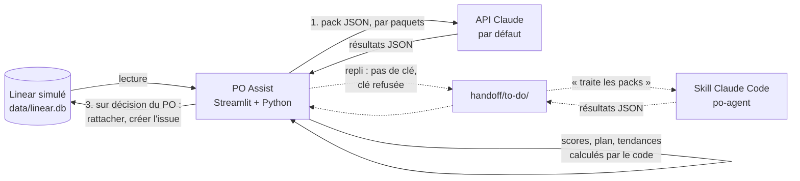

# PO Assist : un agent IA au service du Product Owner

Test technique « Product Builder ». Le sujet est dans [docs/brief/brief.md](docs/brief/brief.md).

PO Assist aide Camille, Product Owner de **saxobeat** (un SaaS de suivi de recherche d'emploi, projeté au printemps 2027), à :

1. **Comprendre** : analyser 80 feedbacks multicanaux (tickets, e-mails, chat intégré), repérer les thèmes et les tendances, extraire les demandes et les relier au backlog.
2. **Arbitrer** : scorer les besoins (RICE, score pondéré réglable, MoSCoW), justifier chaque recommandation par ses preuves, proposer le contenu du sprint dans la limite de la capacité.
3. **Formaliser** : rédiger des user stories (critères Gherkin, contrôle INVEST, estimation, découpage), puis les envoyer dans Linear.

> **Guide utilisateur, pas à pas : [docs/guide-utilisateur.md](docs/guide-utilisateur.md)** (aussi dans l'application, page ❓ Guide).

> Toutes les données sont fictives. Le PO travaille dans **Linear**, simulé par une base SQLite ([data/README.md](data/README.md)).

## Démarrer (2 minutes)

**Sur Mac : double-cliquer sur `PO Assist.command`.** L'application s'ouvre dans le navigateur sur http://localhost:8007. Pour l'arrêter, fermer la fenêtre de Terminal. Prérequis : [uv](https://docs.astral.sh/uv/) ; le lanceur indique comment l'installer s'il manque.

En ligne de commande :

```bash
uv sync                                   # Python ≥ 3.12, dépendances : streamlit (+ pytest en dev)
uv run streamlit run app.py               # interface du PO, sur http://localhost:8007 (.streamlit/config.toml)
```

L'application démarre en **mode démo** : suivez le parcours depuis la page 🤖 Agent (« Lancer l'agent » sur l'analyse, puis la priorisation, puis la rédaction depuis ⚖️ Priorisation). Le parcours est celui de l'intégration API, **simulé** : coût estimé sur le bouton, envoi paquet par paquet, coût affiché, mais aucun appel et rien n'est facturé. Les résultats sont ceux d'un **vrai passage de l'agent, calculés à l'avance** (`handoff/demo/`). La vérification et l'import restent réels, et un bandeau signale le mode. **Réinitialiser** (barre latérale) repart de zéro.

```bash
uv run pytest                             # tests, sans LLM ni réseau ni clé
uv run python -m po_assist status         # même chose en ligne de commande
uv run python -m po_assist.evaluate       # qualité de l'agent contre la vérité terrain
```

## Comment l'IA intervient : l'API par défaut, le skill en repli

L'application prépare le travail d'IA dans des lots auto-suffisants (« packs »), un agent les traite, et l'application **vérifie puis importe** les résultats. Le moteur se choisit dans ⚙️ Réglages :

| Moteur | Ce qui traite le pack | Quand |
|---|---|---|
| **API Claude** (par défaut) | L'application envoie le pack à l'API par paquets : sorties structurées, instructions et contexte en cache, repli serveur en cas de refus. Coût estimé sur le bouton, coût réel affiché ensuite | Usage normal, sans geste manuel. Clé : `ANTHROPIC_API_KEY`, par exemple dans un `.env` à la racine (ignoré par git, chargé par le lanceur Mac) |
| **Skill Claude Code** (repli) | Le skill `.claude/skills/po-agent/` : dans Claude Code, « traite les packs ». C'est l'architecture en production sur saxobeat | **Automatiquement** quand il n'y a pas de clé ou que l'API refuse la requête ; ou par choix, pour travailler sans clé |
| **Mode démo** (activé au démarrage) | Le flux API, simulé : aucun appel, rien n'est facturé ; les résultats sont ceux d'un vrai passage de l'agent, calculés à l'avance | Démonstration, sans attente ni coût |

Dans tous les cas, le format des résultats et la vérification à l'import sont les mêmes.



| Pack | L'IA fait (jugement) | Le code fait (calcul, vérification) |
|---|---|---|
| **analyse** | Classer chaque feedback (type, thèmes, sentiment, risque de churn), extraire chaque demande avec une **citation exacte**, la relier à une issue ou proposer un besoin nouveau | Vérifier les citations (anti-hallucination), compter les clients distincts, la portée (sièges Business), l'ARR à risque, les tendances par semaine |
| **priorisation** | Estimer Impact, Confiance et Effort, proposer MoSCoW et l'OKR servi, justifier avec les preuves | Calculer Reach, RICE et le score pondéré (poids réglables), appliquer les ajustements du PO, proposer le sprint dans la capacité restante |
| **rédaction** | Rédiger la story, les critères Gherkin, le contrôle INVEST, l'estimation et le découpage | Vérifier la structure ; publier dans Linear (création ou commentaire, rattachement des feedbacks) ; exporter en Markdown et en CSV Linear |

**Garde-fous**
- Rien n'est écrit sans vérification.
- Un résultat hors format est refusé avec sa raison.
- Réimporter un fichier ne change rien.
- Un fichier partiel est accepté.
- Le PO valide entre chaque étape, et c'est lui seul qui écrit dans Linear.

## Qualité mesurée (vrai passage du skill sur les 80 feedbacks)

L'agent est comparé à la vérité terrain du jeu de données ([data/ground_truth.json](data/ground_truth.json)), qu'il ne voit jamais :

| Mesure | Résultat |
|---|---|
| Type correct | 84 % |
| Thème principal correct | 96 % |
| Rattachement au backlog (précision / rappel) | 98 % / 95 % |
| Besoins nouveaux repérés | 22 / 22 |
| Risque de churn (précision / rappel) | 78 % / 100 % |
| Aucune demande inventée sur les éloges, le bruit et les messages vagues | 8 / 8 |

Détail, pièges compris : page 🎯 de l'interface, ou [l'évaluation enregistrée](docs/sdlc/cycles/003-bloc-a-comprendre-les-feedbacks/evidence/evaluation_analyse_2026-11-16.md).

## Organisation du dépôt

| Chemin | Contenu |
|---|---|
| `app.py` | Interface du PO (Streamlit), 7 pages |
| `po_assist/linear.py` | Faux connecteur Linear : seul module à remplacer pour se brancher sur le vrai Linear |
| `po_assist/handoff.py` | Export, vérification et import des packs |
| `po_assist/packs/` | Les 3 packs : instructions de l'agent, format de sortie, règles de validation |
| `po_assist/insights.py`, `scoring.py`, `actions.py` | Agrégats (bloc A), scores et plan (bloc B), publication dans Linear et exports (bloc C) |
| `po_assist/evaluate.py` | Mesure de la qualité contre la vérité terrain |
| `.claude/skills/po-agent/` | Le skill Claude Code qui joue l'API |
| `data/` | Espace Linear simulé, fichiers source, vérité terrain |
| `handoff/demo/` | Packs et résultats réels de l'agent, rejouables |
| `docs/` | Démarche et choix techniques ([docs/demarche.md](docs/demarche.md)), journal, cycles `ai-sdlc` |
