# Guide utilisateur de PO Assist

PO Assist est un assistant pour Product Owner. Il lit les feedbacks clients arrivés dans Linear, vous aide à décider quoi faire en priorité, puis rédige les user stories et les envoie dans Linear. **C'est toujours vous qui validez** : l'agent propose, vous importez, vous corrigez, vous envoyez.

L'agent fonctionne par défaut par **l'API Claude**. Sans clé API, l'outil se **replie** sur le skill Claude Code local.

> Les données de démonstration sont fictives : saxobeat, un suivi de recherche d'emploi, projeté au printemps 2027, avec 80 feedbacks, 30 issues au backlog et 60 clients. Linear est simulé.

**Sommaire**
1. Démarrer
2. Vue d'ensemble
3. Le parcours pas à pas (mode démo)
4. Passer en mode réel : API (par défaut) ou skill (repli)
5. Lire les résultats
6. Réglages et remise à zéro
7. Dépannage
8. Glossaire
9. Annexe technique

---

## 1. Démarrer

**Sur Mac**
1. Récupérez la dernière version du dépôt (`git pull`).
2. Double-cliquez sur **`PO Assist.command`**, à la racine du dépôt.
   - Une fenêtre Terminal s'ouvre et prépare l'environnement. La première fois, cela prend une à deux minutes.
   - Votre navigateur s'ouvre ensuite sur **http://localhost:8007**.
3. Pour arrêter l'application, fermez la fenêtre Terminal.

> Si macOS bloque le fichier au premier lancement, faites un clic droit sur **`PO Assist.command`**, puis choisissez **Ouvrir**.

**Sur un autre système**, voir l'annexe technique (§ 9).

L'application s'ouvre en **mode démo**, rappelé par un bandeau 🎬 en haut de chaque page. Dans ce mode :
- le parcours est exactement celui de l'intégration API : bouton avec coût estimé, envoi paquet par paquet, coût affiché ;
- l'API est **simulée** : aucun appel n'est fait et rien n'est facturé ;
- les résultats sont ceux d'un vrai passage de l'agent, calculés à l'avance ;
- la vérification et l'import, eux, sont réels.

## 2. Vue d'ensemble

Le travail se fait en **trois étapes**. Chacune passe par l'agent, et vous validez entre chaque étape.

| Étape | Ce que fait l'agent | Ce que vous faites | Où |
|---|---|---|---|
| **1 · Comprendre** | Il classe chaque feedback (type, thèmes, sentiment, risque de départ) et en extrait les demandes, avec une **citation exacte** du client. Il relie chaque demande à une issue du backlog, ou la signale comme besoin nouveau | Vous importez le résultat, puis vous explorez les tendances, les alertes et les preuves | 🤖 Agent, puis 🏠 Tableau de bord, 📥 Feedbacks, 🧩 Demandes |
| **2 · Arbitrer** | Il estime l'impact, la confiance et l'effort de chaque besoin, propose une priorité MoSCoW et justifie ses choix | Vous importez, corrigez si besoin, comparez les classements et regardez la proposition de sprint | 🤖 Agent, puis ⚖️ Priorisation |
| **3 · Formaliser** | Il rédige les user stories des besoins que vous avez choisis | Vous les relisez, puis les envoyez dans Linear ou les téléchargez | ⚖️ Priorisation, puis 🤖 Agent, puis ✍️ User stories |

La barre latérale de gauche donne accès aux 9 pages. Sous les pages, elle indique pour chaque étape le nombre de tâches faites, en cours chez l'agent et restant à exporter.

## 3. Le parcours pas à pas (mode démo)

### Étape 1 · Comprendre les feedbacks

**1.1. Partez d'un état propre**
- Dans la barre latérale, cliquez sur **« Réinitialiser (état initial) »**.
- Ouvrez la page **« 🤖 Agent »**.
- Trois cartes apparaissent : **« 1 · Analyse des feedbacks »**, **« 2 · Priorisation »** et **« 3 · Rédaction des stories »**. Seule la première peut être lancée : la priorisation n'est **« Disponible après l'import de l'analyse des feedbacks. »**

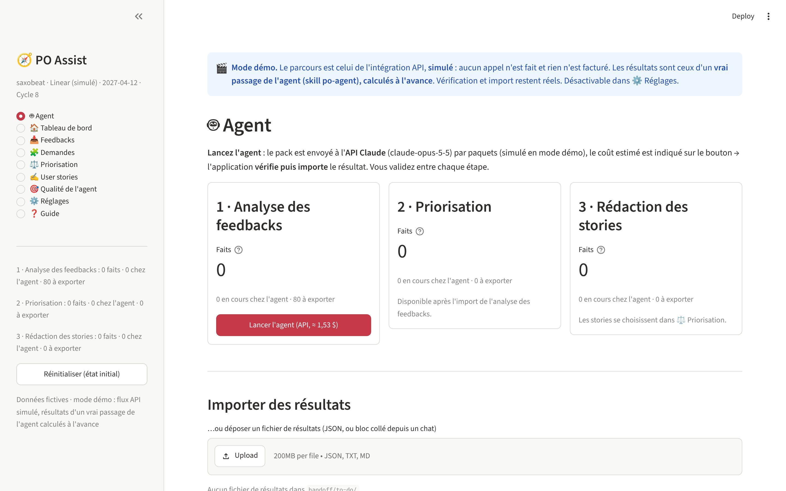

**1.2. Lancez l'agent**
- Sur la carte **« 1 · Analyse des feedbacks »**, cliquez sur **« Lancer l'agent »**. Le bouton affiche le coût estimé de l'appel à l'API, par exemple « Lancer l'agent (API, ≈ 1,53 $) » pour les 80 feedbacks avec Claude Opus 5.5. En mode démo, ce coût est simulé.
- Une barre de progression montre l'envoi à l'API paquet par paquet (« API : paquet 1/4 traité »), en 8 secondes environ en mode démo.
- Un message vert annonce « Résultats prêts », avec le coût : simulé en mode démo, réel sinon.

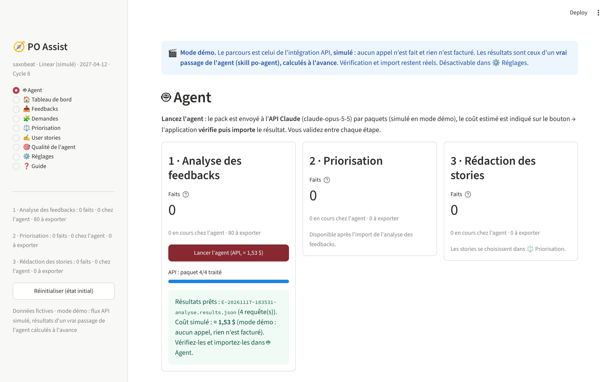

**1.3. Vérifiez, puis importez**
- Descendez jusqu'à **« Importer des résultats »**. Le dernier fichier de résultats est déjà sélectionné.
- Lisez l'aperçu :
  - **Prêts** : ce qui sera importé ;
  - **Refusés** : les résultats hors format ou les citations introuvables dans le feedback. La raison de chaque refus est indiquée, et rien n'est écrit pour eux ;
  - **Ignorés par l'agent** et **Sans résultat** : les tâches qui repartiront au prochain lancement.
- Cliquez sur **« Importer N résultat(s) »**, par exemple « Importer 80 résultat(s) ».

> Avec la case **« Mode strict (un seul refus bloque tout le fichier) »** cochée, un seul refus suffit pour que rien ne soit importé.

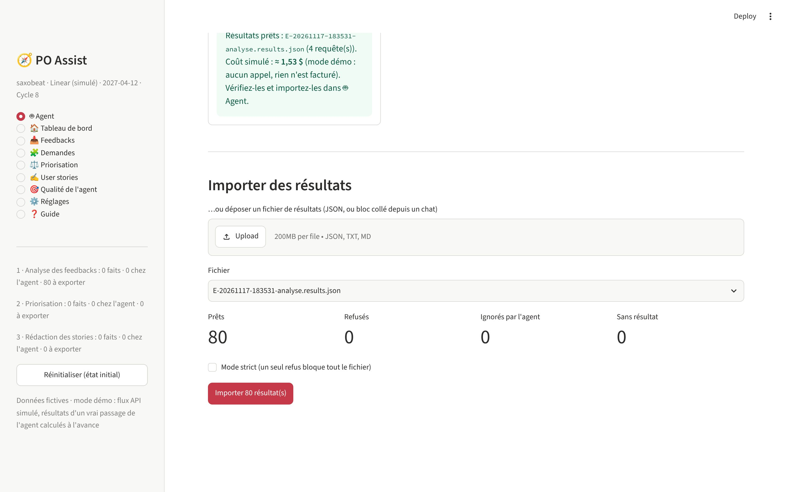

**1.4. Lisez le tableau de bord**

Ouvrez **« 🏠 Tableau de bord »**.

- **En haut**, cinq indicateurs : feedbacks analysés, besoins distincts, besoins nouveaux (absents du backlog), ARR Business à risque, bugs signalés.
- **« Thèmes et tendances »** : le nombre de feedbacks par thème, avec une courbe par semaine et l'évolution entre la première et la seconde moitié de la période.
- **« Besoins les plus demandés »** : les 10 premiers besoins, classés par nombre de clients distincts.
- **À droite, trois alertes** :
  - **« 🚨 Risques de départ »** : les clients qui menacent de partir, du plus gros ARR au plus petit ;
  - **« ↩️ Déjà décidé : informer le client »** : des demandes déjà livrées ou déjà refusées, pour lesquelles il suffit de répondre au client ;
  - **« ❓ À clarifier avec le client »** : les feedbacks trop vagues, avec la question à lui poser.

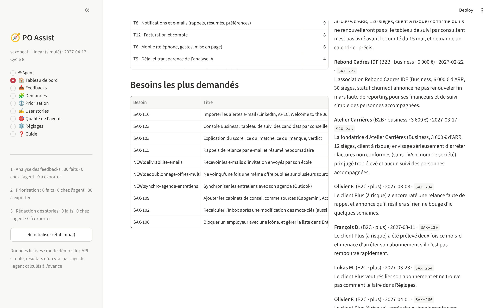

**1.5. Lisez un feedback en détail**
- Ouvrez **« 📥 Feedbacks (file Triage) »**.
- Filtrez si besoin avec **« Canal »**, **« Type »** ou **« Thème »**, ou cochez **« Risque de départ uniquement »**.
- Choisissez un feedback dans **« Détail »** :
  - à gauche, le message tel que le client l'a écrit ;
  - à droite, l'analyse de l'agent : chaque demande avec sa citation entre guillemets et l'issue du backlog qui y correspond.
- Pour ranger ce feedback dans Linear, cliquez sur **« Rattacher dans Linear à … »**. La demande client est ajoutée à l'issue, et le feedback quitte la file Triage.

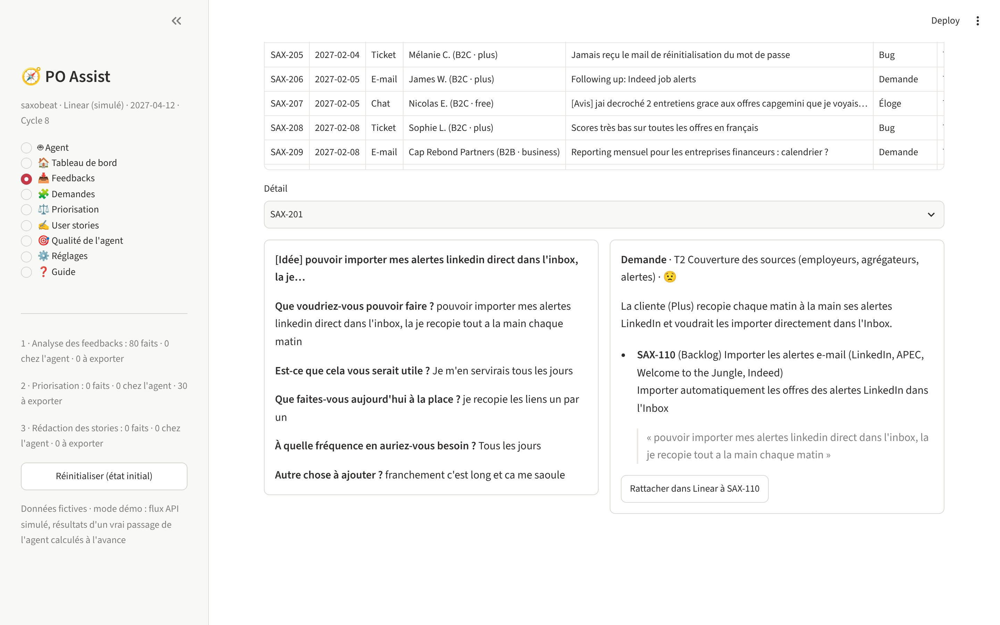

**1.6. Regardez les preuves de chaque besoin**
- Ouvrez **« 🧩 Demandes : chaque besoin, avec ses preuves »**.
- Le tableau liste chaque besoin, avec :
  - le nombre de feedbacks et de demandes antérieures ;
  - les clients distincts, répartis entre B2C et Business ;
  - les personnes touchées ;
  - l'ARR à risque ;
  - la tendance sur 4 semaines.
- Activez **« Besoins nouveaux uniquement (absents du backlog) »** pour voir ce que l'agent propose de créer.
- Dans **« Preuves pour »**, choisissez un besoin : toutes les citations clients qui le fondent s'affichent, avec leur auteur.

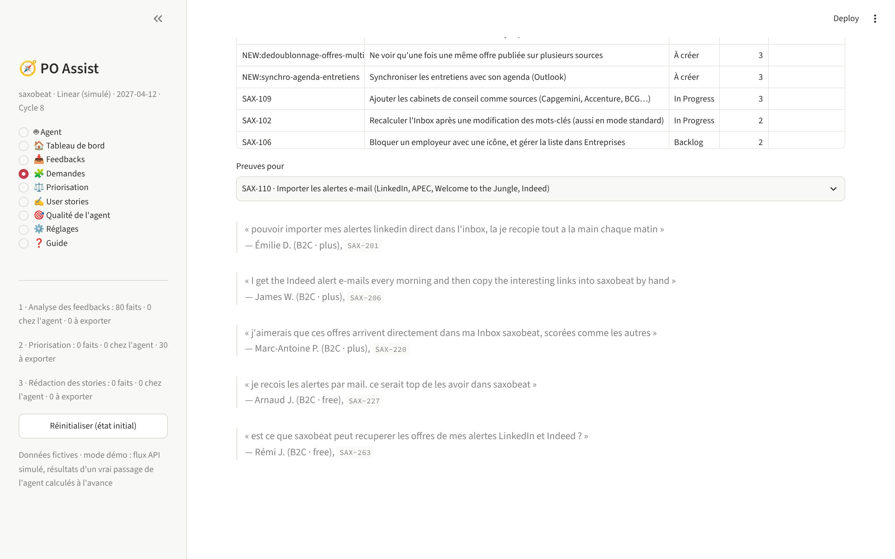

### Étape 2 · Arbitrer

**2.1. Lancez la priorisation**
- Revenez sur **« 🤖 Agent »**. Sur la carte **« 2 · Priorisation »**, cliquez sur **« Lancer l'agent »**.
- Comme à l'étape 1, vérifiez l'aperçu, puis cliquez sur **« Importer N résultat(s) »**.

**2.2. Lisez et ajustez le classement**

Ouvrez **« ⚖️ Priorisation »**.

1. **« Reach compté en »** : choisissez comment compter les personnes touchées.
   - En personnes, un compte Business compte pour son nombre de sièges : cela favorise les besoins Business.
   - En clients, chaque client compte pour un : cela fait remonter les besoins des particuliers.
   - Basculer de l'un à l'autre montre l'arbitrage B2B / B2C. C'est à vous de trancher.
2. **« Classer par »** : **« RICE »** ou **« Score pondéré »**. Pour le score pondéré, réglez les poids des critères dans le volet « Score pondéré : régler les poids ».
3. **Dans le tableau modifiable**, corrigez les estimations de l'agent : impact, confiance, effort, MoSCoW. Les scores et la proposition de sprint se recalculent aussitôt.
4. **« Classement »** affiche le résultat, avec la justification de l'agent sur chaque ligne. Une ligne que vous avez modifiée porte ✏️.

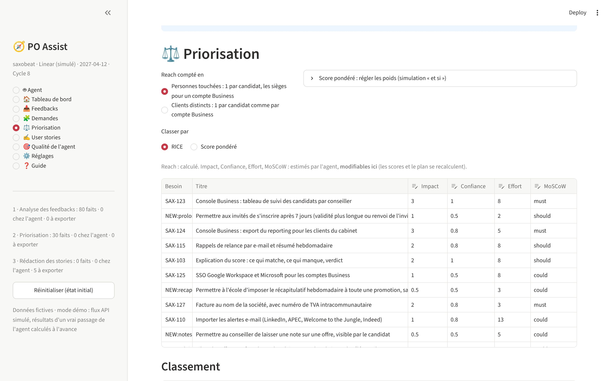

**2.3. Regardez la proposition de sprint**

La section **« Proposition pour le Cycle 8 »** fait le calcul suivant :
- elle part de la capacité de l'équipe (20 points) ;
- elle retire ce qui reste à faire sur les issues déjà en cours ;
- elle remplit ce qui reste, d'abord avec les besoins Must, puis par score.

Un encadré jaune signale les issues déjà planifiées qui ne rentrent plus dans cette capacité.

### Étape 3 · Formaliser

**3.1. Choisissez les besoins à rédiger**
- Toujours dans **« ⚖️ Priorisation »**, descendez jusqu'à **« Rédiger les user stories »**.
- Dans **« Besoins à formaliser »**, gardez ou modifiez la sélection. Par défaut, ce sont les 5 premiers besoins Must ou Should.
- Cliquez sur **« Lancer la rédaction »** (le bouton affiche le coût estimé).

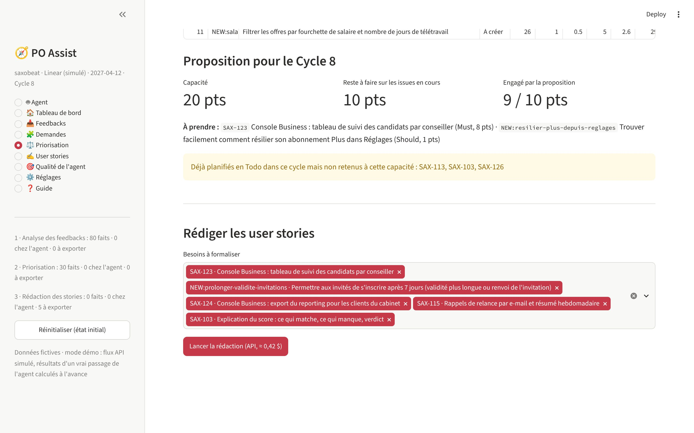

**3.2. Importez les stories**

Sur **« 🤖 Agent »**, vérifiez l'aperçu, puis cliquez sur **« Importer N résultat(s) »**.

**3.3. Relisez, puis envoyez dans Linear**

Ouvrez **« ✍️ User stories »** et dépliez une story. Elle contient :
- la story (« En tant que… je veux… afin de… ») ;
- un contexte chiffré, avec les citations des clients ;
- des critères d'acceptation au format Gherkin (Étant donné / Quand / Alors) ;
- les exigences non fonctionnelles et ce qui est hors périmètre ;
- l'estimation et sa justification ;
- un découpage proposé si la story est trop grosse ;
- les questions ouvertes et le contrôle INVEST.

Pour l'envoyer, cliquez sur **« Envoyer vers Linear »** :
- **pour un besoin nouveau**, une issue est créée ;
- **pour une issue existante**, la story est ajoutée en commentaire.

Dans les deux cas, les feedbacks d'origine sont rattachés à l'issue. La story affiche ensuite « Dans Linear : SAX-… ».

Pour un usage hors de l'application, téléchargez toutes les stories avec **« Télécharger (Markdown) »**, ou avec **« Télécharger (CSV pour import Linear) »**, qui s'importe directement dans Linear.

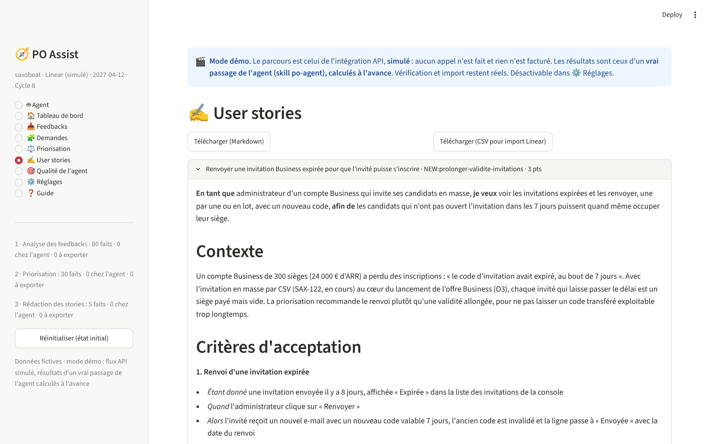

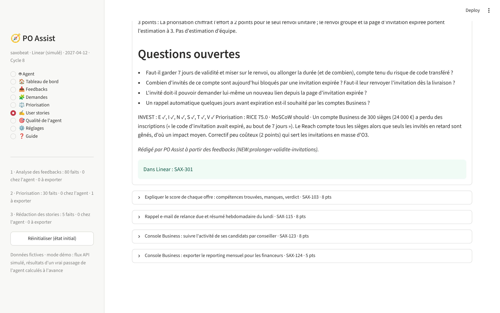

## 4. Passer en mode réel : API (par défaut) ou skill (repli)

Ouvrez **« ⚙️ Réglages »** et désactivez **« Activer le mode démo »**. Le parcours reste le même que dans le § 3 ; seul change ce qui se passe quand vous lancez l'agent.

### 4.1. API Claude (par défaut)

L'application envoie elle-même le travail à l'API : vous n'avez aucun geste manuel à faire.

1. **Prérequis :** une clé API Anthropic. Mettez-la dans un fichier `.env` à la racine du dépôt, sur une ligne `ANTHROPIC_API_KEY=...`. Le lanceur Mac lit ce fichier, git l'ignore, et l'application n'enregistre ni n'affiche jamais la clé. **« ⚙️ Réglages »** indique si une clé est détectée.
2. Dans **« ⚙️ Réglages »**, le **« Moteur de l'agent »** est réglé sur **« API Claude (recommandé) »**. Choisissez le modèle dans **« Modèle (mode API) »** ; Claude Opus 5.5 est recommandé.
3. Sur **« 🤖 Agent »**, le bouton annonce le coût estimé, par exemple « Lancer l'agent (API, ≈ 1,53 $) ». Le clic vaut confirmation.
4. Une progression s'affiche paquet par paquet, puis le **coût réel** apparaît. Vérifiez l'aperçu et importez, comme au § 3.

> Si l'API refuse une partie du travail (refus du modèle, erreur réseau), seules les tâches concernées reviennent « ignorées », avec la raison. Elles repartiront au prochain lancement.

### 4.2. Le repli sur le skill Claude Code

L'outil se replie **automatiquement** sur le skill Claude Code local dans deux cas :
- aucune clé API n'est détectée ;
- l'API refuse la requête dès le premier paquet (clé invalide, modèle inaccessible).

Un bandeau ↩️ en indique la raison, et le bouton devient **« Exporter »**. Vous pouvez aussi choisir le skill vous-même dans **« ⚙️ Réglages »** : **« Skill Claude Code, en local (repli) »**. Ce moteur ne demande aucune clé.

1. Sur **« 🤖 Agent »**, cliquez sur **« Exporter »**. Un fichier de travail (un « pack ») est écrit dans `handoff/to-do/`.
2. Dans Claude Code, ouvert dans le dossier du dépôt, dites : **« traite les packs »**. Le skill `po-agent` lit le pack et écrit le fichier de résultats à côté. Comptez 3 à 4 minutes pour 80 feedbacks.
3. Revenez sur **« 🤖 Agent »**. Le fichier apparaît dans **« Importer des résultats »** : vérifiez l'aperçu, puis importez.

Pour l'étape 3, le bouton de la page Priorisation exporte le pack de rédaction ; la suite est identique.

## 5. Lire les résultats

| Notion | Comment la lire |
|---|---|
| **Citation** | Phrase copiée mot pour mot du feedback. L'application vérifie qu'elle s'y trouve vraiment : c'est le garde-fou contre les demandes inventées |
| **Besoin nouveau** (`NEW:…`) | Besoin absent du backlog. Plusieurs feedbacks qui expriment le même besoin partagent le même identifiant |
| **Personnes touchées (Reach)** | Calculé par l'application, jamais par l'IA : 1 par candidat, le nombre de sièges pour un compte Business, ou 1 par client selon votre réglage |
| **Impact, confiance, effort** | Estimés par l'agent, avec une justification ; modifiables par vous. Impact : 3 massif, 2 fort, 1 moyen, 0,5 faible, 0,25 minimal. Confiance : 1, 0,8 ou 0,5. Effort : en points Fibonacci (1, 2, 3, 5, 8, 13) |
| **RICE** | Reach × Impact × Confiance ÷ Effort. Plus il est haut, plus le besoin rapporte par point d'effort |
| **Score pondéré** | Note de 0 à 100 qui combine 5 critères (personnes touchées, impact, ARR à risque, alignement avec un objectif du trimestre, demandes récentes) selon vos poids |
| **MoSCoW** | Must, Should, Could, Won't, pour le trimestre. Must est réservé à ce qui bloque un objectif, fait perdre des clients ou casse le produit |
| **Qualité de l'agent** | La page **« 🎯 Qualité de l'agent »** compare l'analyse à une vérité terrain que l'agent n'a jamais vue : types, thèmes, rattachements, besoins nouveaux, risques de départ, pièges |

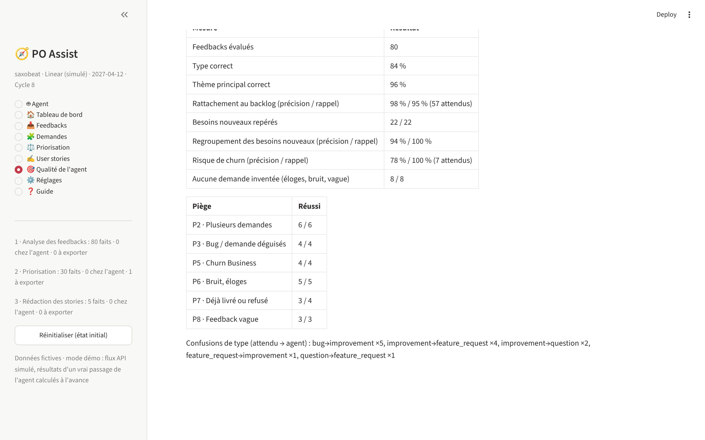

## 6. Réglages et remise à zéro

- **« ⚙️ Réglages »** regroupe :
  - le mode démo, activé par défaut ;
  - le moteur de l'agent (l'API par défaut, le skill en repli) et le modèle ;
  - l'état de la clé API ;
  - le nombre de résultats pré-calculés disponibles.

  Les réglages sont conservés d'une session à l'autre.
- **« Réinitialiser (état initial) »**, dans la barre latérale, efface tous les résultats importés et repart d'un espace Linear neuf. Vos réglages sont conservés.
- La démonstration n'altère jamais les données d'origine : l'application travaille sur une copie.

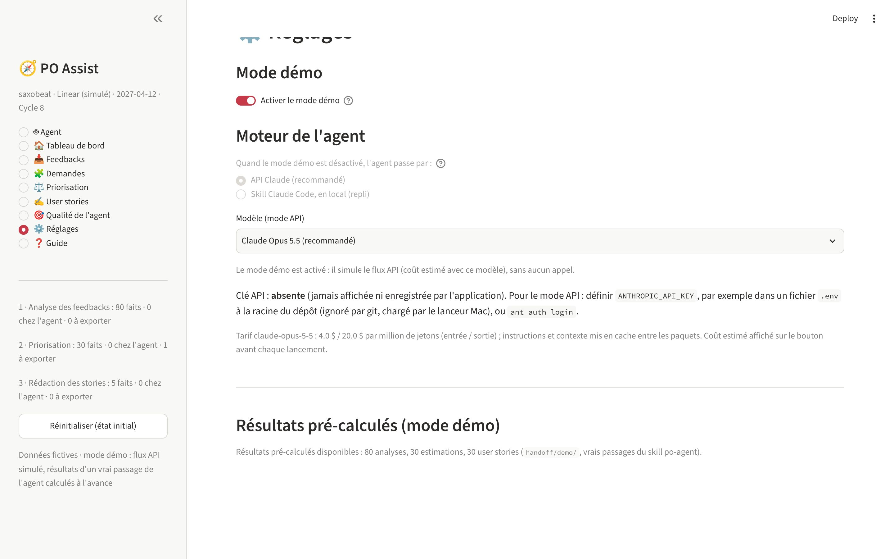

## 7. Dépannage

| Symptôme | Que faire |
|---|---|
| Le lanceur dit « uv est introuvable » | Installez uv avec la commande affichée (`curl -LsSf https://astral.sh/uv/install.sh \| sh` ou `brew install uv`), puis relancez |
| Le lanceur dit que le port 8007 est utilisé par un autre programme | Fermez le programme qu'il nomme, puis relancez. Si c'est PO Assist qui tourne déjà, le lanceur ouvre simplement le navigateur |
| macOS refuse d'ouvrir `PO Assist.command` | Clic droit sur le fichier, puis **Ouvrir** |
| La carte Priorisation reste grisée | L'analyse doit d'abord être importée (étape 1.3) |
| « Rien à traiter : tout est déjà fait ou déjà chez l'agent » | Tout est déjà importé ou un fichier attend dans « Importer des résultats ». Pour recommencer : **« Réinitialiser (état initial) »** |
| L'aperçu affiche des refusés | Lisez la raison de chaque refus (citation absente, valeur hors liste…). Importez les résultats valides ; les refusés repartiront au prochain lancement |
| « Déjà importé le … : rien à faire » | Ce fichier a déjà été importé ; le réimporter ne change rien |
| Bandeau ↩️ « Aucune clé API détectée : repli sur le skill… » | L'outil fonctionne avec le skill (§ 4.2). Pour utiliser l'API : ajoutez `ANTHROPIC_API_KEY=...` dans `.env`, puis relancez avec le lanceur ; ou connectez-vous avec `ant auth login` |
| Bandeau ↩️ « L'API refuse la requête… Repli sur le skill » | Le pack a été exporté pour le skill (§ 4.2). Vérifiez la clé et le modèle dans **« ⚙️ Réglages »** |

## 8. Glossaire

| Terme | Sens |
|---|---|
| **Linear** | L'outil de gestion de backlog du PO, simulé ici par une base SQLite |
| **Triage** | La file d'entrée de Linear, où arrivent tickets, e-mails et messages du chat |
| **Pack** | Lot de travail exporté pour l'agent. Il contient tout ce dont l'agent a besoin : instructions, contexte, tâches |
| **API Claude** | Le moteur par défaut : l'application envoie elle-même les packs au modèle |
| **Skill `po-agent`** | Le moteur de repli : la compétence Claude Code qui traite les packs en local, sans clé API |
| **Mode démo** | Le flux API simulé : aucun appel, rien n'est facturé ; les résultats sont ceux d'un vrai passage de l'agent, calculés à l'avance. Vérification et import restent réels |
| **ARR** | Revenu annuel récurrent d'un compte Business |
| **B2C / Business** | Candidats individuels (offres Free et Plus) / cabinets d'outplacement, écoles, coachs |
| **OKR** | Les trois objectifs du trimestre : conversion Free → Plus, activation, lancement de l'offre Business |
| **INVEST** | Contrôle de qualité d'une story : Indépendante, Négociable, Valeur, Estimable, Small (petite), Testable |
| **Gherkin** | Format des critères d'acceptation : Étant donné / Quand / Alors |

## 9. Annexe technique

**Installation sans le lanceur** (macOS, Linux ou Windows, avec [uv](https://docs.astral.sh/uv/))

```bash
uv sync
uv run streamlit run app.py        # http://localhost:8007
```

**Ligne de commande** (mêmes étapes que l'interface)

```bash
uv run python -m po_assist status                           # où en est chaque étape
uv run python -m po_assist run analyse                      # moteur des réglages (API, repli skill)
uv run python -m po_assist run analyse --engine api --limit 5   # API, sur 5 tâches
uv run python -m po_assist run analyse --engine demo        # API simulée (mode démo)
uv run python -m po_assist export analyse                   # écrire un pack pour le skill
uv run python -m po_assist import --dry-run                 # vérifier sans rien écrire
uv run python -m po_assist import                           # importer les résultats en attente
uv run python -m po_assist.evaluate                         # qualité de l'agent
uv run pytest                                               # tests
```

**Fichiers utiles**

| Fichier ou dossier | Rôle |
|---|---|
| `handoff/to-do/` | Les packs en attente, et les résultats posés à côté |
| `handoff/done/` | Les packs et résultats importés |
| `handoff/problems/` | Les fichiers refusés, avec une note qui explique pourquoi |
| `handoff/demo/` | Les résultats réels du skill utilisés par le mode démo |
| `data/workspace/` | La copie de travail (Linear, résultats, réglages), recréée par « Réinitialiser » |
